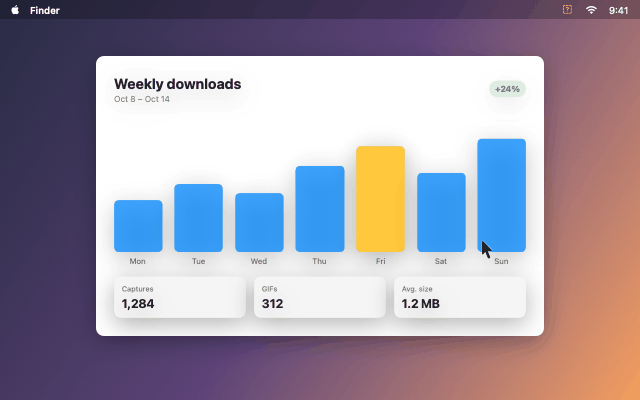
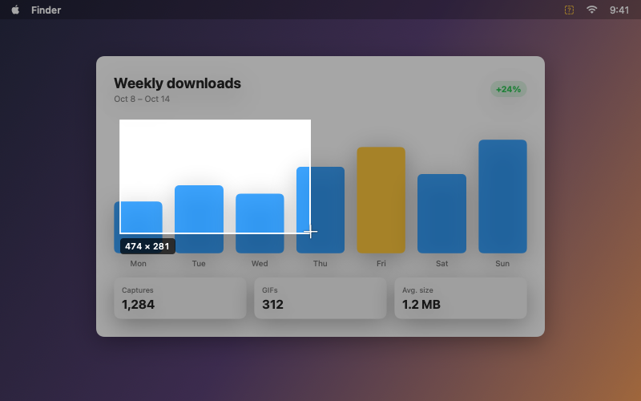
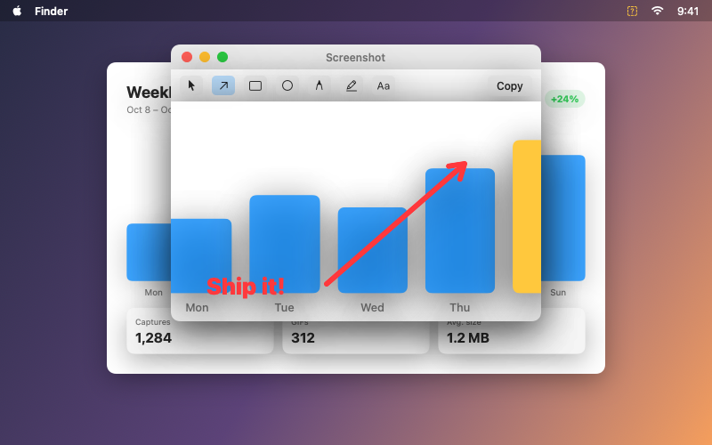
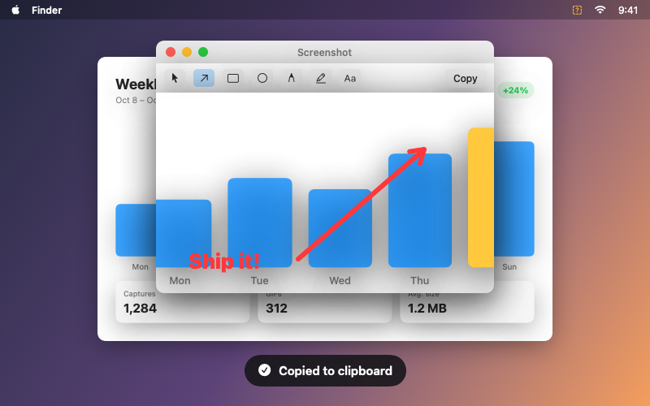
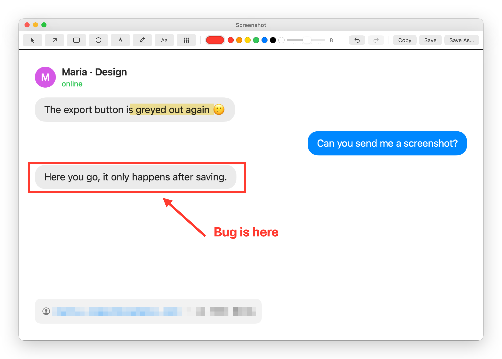
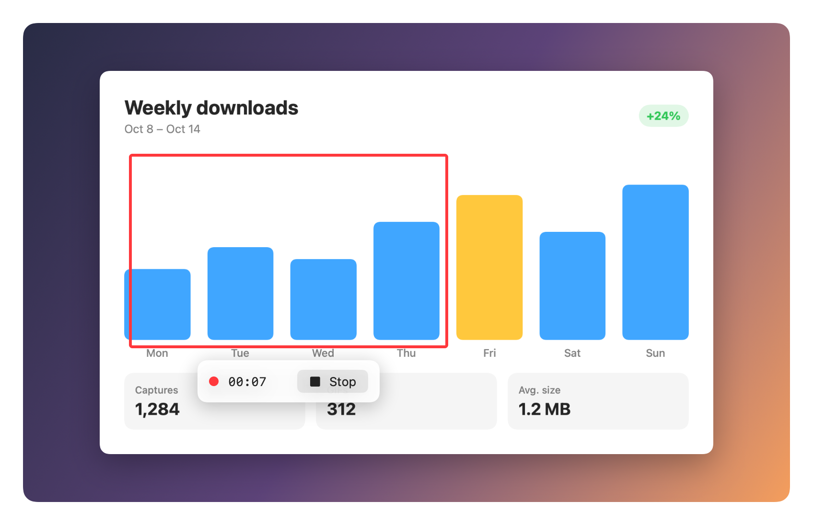
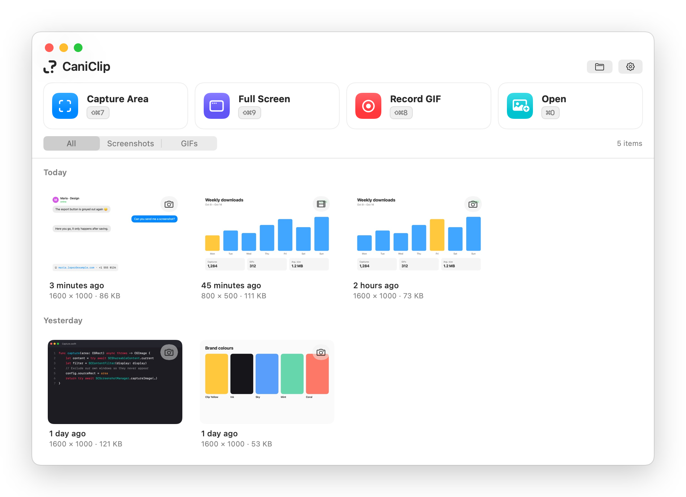

<p align="center">
  
</p>

<p align="center"><b>Screenshot, annotate and record GIFs on your Mac.</b><br>One shortcut. No account. Free for non-commercial use.</p>

<p align="center">
  <a href="https://github.com/Flamentist/caniclip/actions/workflows/ci.yml"></a>
  
  
  <a href="LICENSE.md"></a>
</p>

---

## 👀 See it

<p align="center">
  
</p>

## 🪄 How it works

| 1. Select | 2. Mark it up | 3. Paste anywhere |
|:---:|:---:|:---:|
|  |  |  |
| Press `⇧⌘7`, drag over anything | Arrows, boxes, text, highlighter | Copied. Paste into Slack, Mail, Docs… |

---

## ✏️ Annotate



- **Arrow, box, circle, pen, highlighter, text**
- **Pixelate** hides emails, phone numbers and passwords
- **Undo** everything with `⌘Z`
- **Copy** `⇧⌘C` or **save** `⌘S`

## 📥 Open and paste

- **Drop** an image on the CaniClip window or its Dock icon
- Or press `⌘O` to **open** one, or `⌘V` in CaniClip to **paste** one (`⇧⌘V` from the menu)
- It opens in the editor, ready to mark up
- Your original file is never changed. Save makes a new PNG

## 🎞️ Record GIFs



- Press `⇧⌘8`, drag an area (or click for the **full screen**), then click **Start**
- Press `⇧⌘8` again to stop
- The GIF is saved **and** copied, ready to drop into an issue or chat
- Pick frame rate, size and quality in **Settings → Recording**

## 🗂️ Everything in one place



- Click the **Dock icon** to open it
- Every capture lands here, even ones you only copied
- Hover a card: **Open · Copy · Reveal · Delete**
- History clears itself after 30 days (change it in **Settings → General**)

---

## ⌨️ Shortcuts

| Do this | Press |
|---|---|
| Capture an area | `⇧⌘7` |
| Record a GIF of an area or the full screen | `⇧⌘8` (again to stop) |
| Capture the full screen | `⇧⌘9` |
| Open an image | `⌘O` (in CaniClip) |
| Paste an image | `⌘V` in CaniClip, or `⇧⌘V` |
| Cancel a selection | `Esc` |
| Square selection | hold `⇧` while dragging |
| Move the selection | hold `Space` while dragging |

Change any shortcut in **Settings → Shortcuts**.

## 🚀 Install

No download yet. Build it in 3 steps:

**1. Get the tools** (once)

```bash
brew install xcodegen
curl --proto '=https' --tlsv1.2 -sSf https://sh.rustup.rs | sh
```

Plus **Xcode 26** from the App Store.

**2. Get the code**

```bash
git clone https://github.com/Flamentist/caniclip.git && cd caniclip
```

**3. Build and open it**

```bash
./scripts/run.sh
```

> **First launch:** macOS asks for **Screen Recording** permission. Allow it, then quit and reopen CaniClip.

## ✅ Can I use it?

| | |
|---|---|
| Use it yourself | ✅ Yes |
| Use it at school, a nonprofit or a public institution | ✅ Yes |
| Change it and share it for free | ✅ Yes, keep the licence and [NOTICE](NOTICE) |
| Sell it, or put it in a paid product | ❌ No |
| Use it for a company's commercial work | ❌ No |

Licence: [PolyForm Noncommercial 1.0.0](LICENSE.md).
The code is public and free, but it's **source-available**, not "open source" by the official definition, because selling isn't allowed.

## 🛠️ Contribute

Bugs and ideas: [open an issue](https://github.com/Flamentist/caniclip/issues).
Code: read [CONTRIBUTING.md](CONTRIBUTING.md) first. It's short.

<details>
<summary><b>How it's built</b></summary>

<br>

| Part | Tech |
|---|---|
| App, windows, hotkeys, capture | Swift, AppKit, SwiftUI, ScreenCaptureKit |
| GIF encoding, pixelate | Rust (`core/`), bridged with UniFFI |
| Xcode project | Generated by XcodeGen from `project.yml` |

**Folders**

- `CaniClip/` the app
- `core/` the Rust library
- `CaniClipTests/`, `core/tests/` tests
- `design/` the logo, the hero illustration and the scripts that draw them
- `docs/media/` README images
- `docs/superpowers/` design notes and plans

**Run the tests**

```bash
(cd core && cargo test)
xcodebuild test -project CaniClip.xcodeproj -scheme CaniClip -destination 'platform=macOS,arch=arm64'
```

</details>

<details>
<summary><b>About these images</b></summary>

<br>

The screenshots are drawn from the app's real views, filled with made-up sample captures. The demo GIF was encoded by CaniClip's own GIF encoder. Regenerate them all with:

```bash
TEST_RUNNER_CANICLIP_README_ASSETS="$PWD/docs/media" xcodebuild test -project CaniClip.xcodeproj -scheme CaniClip -destination 'platform=macOS,arch=arm64' -only-testing:CaniClipTests/ReadmeAssetTests
python3 design/readme/build_hero.py
```

</details>

<details>
<summary><b>Troubleshooting</b></summary>

<br>

- **Generic icon in the Dock?** Run `killall Dock`.
- **Captures are black or blank?** Turn on CaniClip in **System Settings → Privacy & Security → Screen Recording**, then reopen it.
- **Don't want a Dock icon?** Turn off **Settings → General → Show in Dock**.

</details>

---

<p align="center"><sub>© 2026 Akosiyawin · <a href="LICENSE.md">PolyForm Noncommercial 1.0.0</a> · <a href="THIRD_PARTY_NOTICES.md">Third-party notices</a></sub></p>
